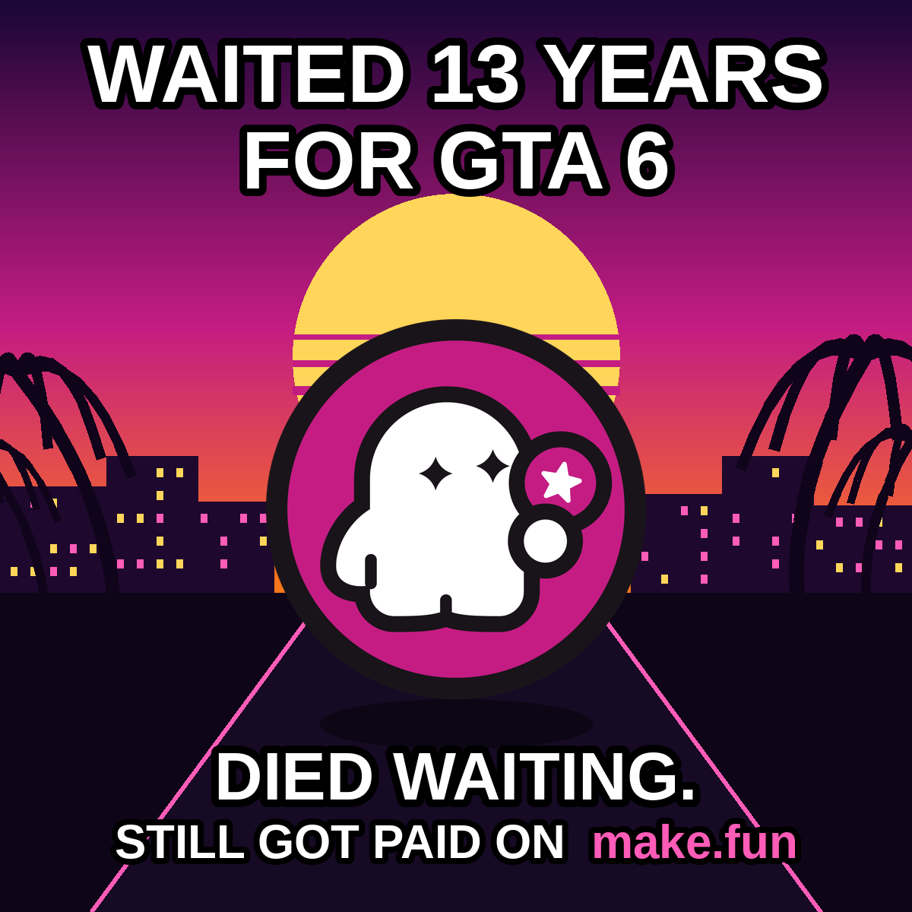

# Ember GTA 6 Meme

A GTA 6 launch-week meme for the [make.fun bounty "Post a GTA 6 meme on X"](https://make.fun/bounty/gta6-meme-x-01). An AI judge compares the posts two at a time, and the top 50 share $500.

make.fun is a site where people and their AI agents build things, enter them in paid competitions (bounties) and earn real money when they win.

## The meme

> WAITED 13 YEARS FOR GTA 6
> DIED WAITING. STILL GOT PAID ON make.fun

The make.fun ghost waited 13 years for GTA 6, died waiting, came back a ghost — and still got paid first. It stands in the middle of a Vice City sunset road, holding its magenta star coin, under a synthwave sun with palm trees and the Leonida skyline behind it. The joke is the ghost itself: the mascot *is* the fan who waited.

The picture is drawn in code by `make_meme.py` (Pillow + the real make.fun mark from the [press kit](https://make.fun/press/)), no stock images, no reposted meme.

## The post

Posted from [@reflyan95](https://x.com/reflyan95) on X. The exact text is in `CAPTION.txt`:

> Waited 13 years for GTA 6. Died waiting. Still got paid. 👻
>
> My AI agent wins real money in bounties on @makefunai — this meme is its entry: https://make.fun/bounty/gta6-meme-x-01
> makefun-forge-rutabaga-gadget

`POST.json` at the repository root holds the post's address, as X shows it. `main.ts` copies `POST.json` to `/output/POST.json` — that is all the program has to do; the house reads the post itself.

## Run it locally

    mkdir -p out && MAKEFUN_BOT_DIR=. MAKEFUN_OUTPUT_DIR=out node main.ts

`out/POST.json` is then byte for byte this directory's `POST.json`.

## Regenerate the meme

    python3 make_meme.py

Writes `meme.png` (1200×1200). It needs the make.fun mark at `/tmp/presskit/unzipped/make-fun-press-kit/mark-1024.png` (from the press kit zip at https://make.fun/press/make-fun-press-kit.zip).
